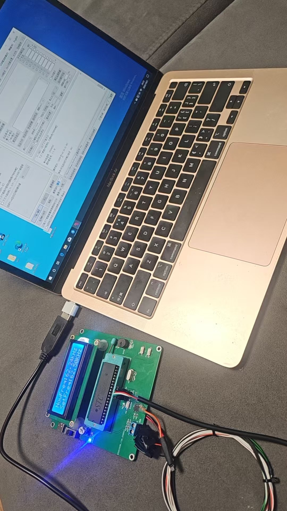
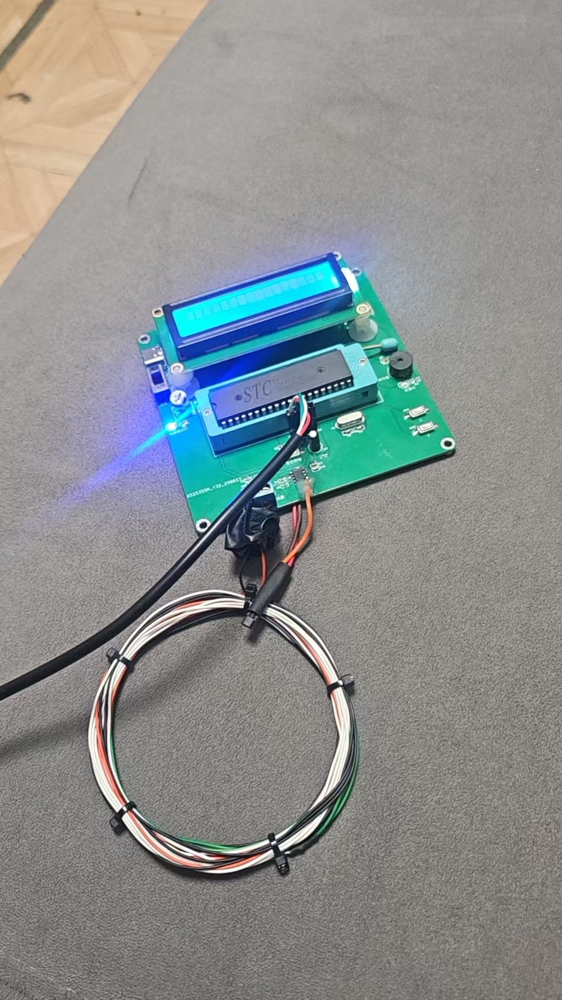

# 霍尔金属探测器（51 单片机）

这是一个硬件小制作，不是软件项目：用 STC 51 单片机加霍尔传感器做一台金属探测器。原理是金属靠近时会引起探测线圈周围的磁场扰动，霍尔传感器把这个变化转成频率偏移，单片机在固定时间窗里对脉冲计数算出当前频率，超过设定的阈值就驱动 LED 和蜂鸣器报警。

电路上的几个要点：

测频靠定时器/计数器，定时器中断里累计脉冲，固定时间窗到了把计数换算成频率交给主循环显示和比较。报警阈值不是写死的，用两个按键可以上下调，每按一次固定步进；调好的值写进 EEPROM，断电再上电也不丢，开机时从 EEPROM 读回来显示在屏上。显示用的 LCD1602，第一行是当前频率，第二行是设定阈值，调试的时候看着数字变化调传感器很直观。另外留了一个测试按键，手动触发一次声光报警，检查报警电路是否正常。

下面两张是装置做出来以后实际运行的实物照片。

